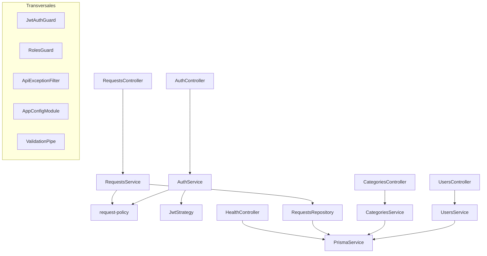

# C4 — Componentes de la API

`request-policy` queda en el centro: autorización y máquina de estados no pasan por Prisma. `RequestsRepository` está entre `RequestsService` y Prisma. `ApiExceptionFilter` traduce `P2002` a 409 y `P2025` a 404. `JwtAuthGuard`, `RolesGuard`, `ValidationPipe` y `AppConfigModule` cruzan todos los módulos.
