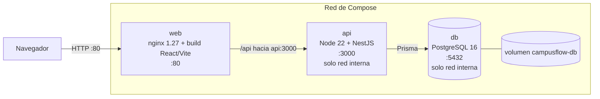

# C4 — Contenedores

En producción solo `web` publica el puerto 80. `api` y `db` quedan en la red interna. El volumen `campusflow-db` conserva los datos de PostgreSQL.

El cliente de desarrollo no es ese contenedor: Vite escucha en `::` puerto 5173 y proxya `/api` a `http://127.0.0.1:3000`. La migración no es un contenedor permanente: el servicio `migrate` usa la imagen de la API, ejecuta `prisma migrate deploy` y termina antes de que arranque `api`.
