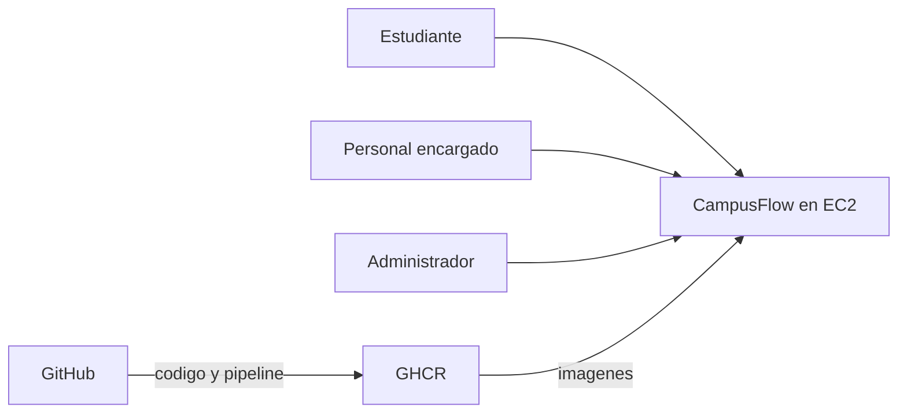

# C4 — Contexto

Las tres personas usan el navegador. Son roles de la universidad y el trámite se registra en CampusFlow, sin un conector hacia sistemas académicos, de directorio o de correo.

Para operar, el software necesita tres piezas fuera del monolito: GitHub guarda el código y ejecuta el pipeline, GHCR guarda las imágenes `campusflow-api` y `campusflow-web`, y AWS EC2 (t3.micro) ejecuta `compose.prod.yml`. Esa es la integración de plataforma. No hay intercambio de datos con otro sistema de la universidad en este incremento.
