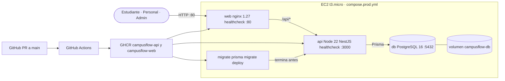

# Despliegue

GitHub Actions construye las dos imágenes, las analiza con Trivy y, solo en `main`, las publica en GHCR. El despliegue copia `compose.prod.yml` a la EC2 y ejecuta `docker compose pull` y `up -d --wait`. El `.env` de producción permanece en la máquina. Después, `GET /api/health` debe devolver la versión del commit.
