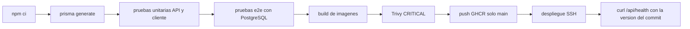

# Integración y entrega

El workflow `.github/workflows/ci.yml` corre en pull requests y en `dev`, `qa` y `main`. Instala API y cliente, genera Prisma, ejecuta las pruebas unitarias, levanta PostgreSQL 16 con la base `campusflow_test` y ejecuta el paso `Pruebas e2e`. La contraseña de ese servicio es `ci-job-only`: vale solo dentro del job y no es una credencial reutilizable.

Después de las pruebas, el job `Imágenes` construye la API con `--target prod` y `APP_VERSION` igual a los siete primeros caracteres del commit, construye el cliente, y ejecuta `trivy image --severity CRITICAL --ignore-unfixed`. El push a GHCR (`campusflow-api` y `campusflow-web`, nombre en minúsculas) ocurre solo en `main`. El job `Despliegue` usa los secretos `EC2_HOST` y `EC2_SSH_KEY`, copia `compose.prod.yml` y espera a que `/api/health` devuelva esa versión. El `.env` de producción no se copia: vive en la EC2.

`.github/workflows/living-docs.yml` sigue comprobando que un cambio de API, cliente, datos o Docker actualice la documentación mapeada en `.living-docs.json`.
